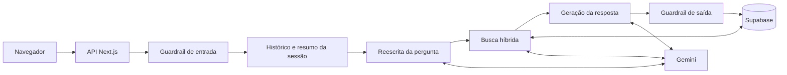

# Chapa

Assistente que tira dúvidas operacionais de restaurantes que já são parceiros de um app de delivery. Ele responde sobre taxas e planos, repasse, cancelamentos, cardápio, horários, avaliações e embalagem, sempre citando de qual documento tirou a resposta.

> **Projeto pessoal de estudo, não oficial e sem afiliação com nenhuma empresa de delivery.** A base de conhecimento é texto público reescrito com palavras próprias, e os números que aparecem nela trazem a fonte e a data de consulta.

## Sobre o projeto

O Chapa existe para estudar, num problema concreto e de ponta a ponta:

- **RAG híbrido:** busca semântica com embeddings somada à busca por palavras-chave em português.
- **Memória de conversa:** histórico recente e resumo persistido por sessão.
- **Guardrails:** bloqueio de dados sensíveis na entrada e checagem da resposta antes de exibi-la.
- **Avaliação:** 20 perguntas com métricas comparáveis entre uma configuração ingênua e uma calibrada.
- **Desenvolvimento guiado por specs com agentes de código:** cada parte do sistema é uma spec implementada por um subagente e revisada antes de entrar na `main`.

Como é um projeto de estudo feito por uma pessoa, várias decisões priorizam simplicidade, custo zero e foco no que se quer aprender. Elas estão listadas em [Decisões tomadas para simplificar](#decisões-tomadas-para-simplificar).

## O que o assistente faz

- Responde só com base nos documentos da pasta `knowledge-base/` e mostra os arquivos usados como fontes.
- Quando a resposta não está na base, ou a pergunta foge do escopo, devolve uma mensagem fixa que encaminha ao suporte. Se nenhum trecho da base for relevante, nem chega a chamar o modelo de resposta.
- Usa o perfil do restaurante (nome, plano, cozinha, cidade e horário) para personalizar a resposta.
- Recusa mensagens com CPF, número de cartão ou senha, sem bloquear perguntas legítimas como "O repasse cai via Pix?".
- Explica como fazer as coisas, mas não executa ações nem altera dados do parceiro.

Cadastro de novos restaurantes fica fora do escopo.

## Como funciona

Uma mensagem passa pelo guardrail de entrada, recupera o histórico e o resumo da sessão, reescreve a pergunta com esse contexto, busca os trechos mais relevantes, gera a resposta e passa pelo guardrail de saída. Só a pergunta original e a resposta final são salvas. Os trechos recuperados nunca vão para o banco.

O detalhamento está no [`ARCHITECTURE.md`](ARCHITECTURE.md).

## Stack

| Camada | Escolha |
|---|---|
| Aplicação | Next.js (App Router), React e TypeScript, front e API num projeto só |
| Interface | Tailwind CSS e shadcn/ui |
| Banco | Supabase: Postgres com pgvector e busca textual em português |
| LLM | Gemini, pelo SDK `@google/genai`, para chat e embeddings |
| Qualidade | Vitest, Biome e GitHub Actions |
| Hospedagem | Vercel, com Vercel Cron para a limpeza diária |

## Decisões tomadas para simplificar

Algumas escolhas foram feitas para facilitar o desenvolvimento e manter o custo em zero, não porque seriam as melhores num produto real. A tabela mostra cada uma e o que mudaria fora de um contexto de estudo.

| Decisão | Por que simplifica | Num produto real |
|---|---|---|
| Sem login: sessão anônima e um link de continuação ([ADR 0010](docs/adr/0010-link-de-continuacao-em-vez-de-login.md)) | Quem avalia testa a demo sem criar conta, e nenhum e-mail é guardado | Login do parceiro, com os dados vindos da conta |
| Perfil do restaurante preenchido num formulário | Dispensa integração com dados reais | Perfil lido da conta do parceiro |
| Só parceiros atuais no escopo ([ADR 0011](docs/adr/0011-somente-parceiros-atuais.md)) | Uma base menor e uma avaliação mais focada | Também o público de cadastro, com base e tom próprios |
| Base com 7 documentos reescritos a partir de páginas públicas | Conteúdo controlado e revisado, sem copiar páginas | Ingestão automática e atualizada da central de ajuda oficial |
| Só o Gemini, no plano gratuito ([ADR 0009](docs/adr/0009-somente-gemini.md)) | Custo zero, sem cartão e com um único SDK | Plano pago, com cota e garantias de disponibilidade |
| RAG, memória e guardrails escritos à mão, sem framework de agente ([ADR 0002](docs/adr/0002-sem-framework-de-agente.md)) | Cada passo fica visível e testável | Mesma abordagem para um fluxo fixo; um framework se o assistente precisar escolher ferramentas |
| Busca vetorial exata, sem índice | Basta para menos de 500 trechos | Índice HNSW quando a base crescer |
| Guardrails por padrões (CPF, cartão, senha) | Regras previsíveis, testáveis e sem custo de API | Também um classificador ou um serviço de moderação |
| Respostas completas, sem streaming ([ADR 0004](docs/adr/0004-sem-streaming.md)) | O guardrail de saída vê a resposta inteira antes do usuário | Streaming com uma checagem que acompanhe o texto |
| Rate limit por IP guardado no próprio Postgres | Nenhum serviço a mais para manter | Um armazenamento dedicado, como Redis |
| Ingestão, migrações e rodadas de avaliação manuais | Controle sobre o que chama API e grava em banco | Pipelines automatizados |
| Avaliação com 20 perguntas e juiz opcional | Cabe na cota gratuita | Um conjunto maior, rodando a cada mudança |

As decisões de arquitetura completas, com contexto e alternativas, estão em [`docs/adr/`](docs/adr/README.md).

## Como o projeto é construído

O trabalho está dividido em 11 specs ([`specs/`](specs/README.md)), da S00 (estrutura do projeto) à S10 (documentação final). Cada spec lista os arquivos que pode tocar, os contratos que cria e usa e os critérios de aceite.

- Specs sem dependência entre si rodam em paralelo, em ondas, cada uma com um subagente no seu próprio `git worktree`.
- Cada spec vira uma branch e um PR. A `main` só recebe código por PR com a CI verde.
- Os passos que exigem conta, chave de API ou publicação são checkpoints em que a pessoa age.

As regras para os agentes ficam no [`AGENTS.md`](AGENTS.md).

## Estado

Em desenvolvimento. O passo a passo para rodar localmente, o link da demo e os resultados da avaliação entram neste README na spec S10.
