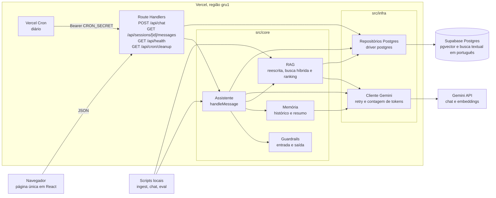

# Chapa

Restaurantes parceiros da Rango, uma empresa de delivery fictícia, repetem as mesmas dúvidas operacionais, e a resposta está espalhada pela política de parceiros. O Chapa responde com RAG híbrido sobre essa base, cita as fontes e recusa o que está fora do escopo.

**Demo:** https://chapa-mu.vercel.app. Para testar, clique em **"Testar como demo"**: uma conta de demonstração é criada na hora, sem preencher nada, e apagada em 7 dias com as conversas. Quem quiser guardar as conversas entra com Google.

> **Restaurante (perfil: Cantina do Beto, Plano Próprio):** Qual é a comissão que eu pago por pedido?
>
> **Chapa:** Fala, Beto! Como você está no Plano Próprio, a sua comissão é de 11% sobre o valor dos itens de cada pedido.<br>
> Fontes: `01-planos-e-taxas.md`, `02-repasse-financeiro.md`
>
> **Restaurante:** Você tem uma receita boa de massa de pizza de fermentação longa?
>
> **Chapa:** Não encontrei essa informação na base do parceiro. Fale com o suporte pelo Painel Rango.<br>
> *(nenhum trecho passou do `minScore`, então o modelo de resposta nem foi chamado)*

<sub>Respostas reais das perguntas 122 e 142 da rodada `v3` ([`eval/resultados/v3.json`](eval/resultados/v3.json)). Na 122, o plano vem só do perfil do restaurante.</sub>

| Métrica (50 perguntas, 36 no escopo) | Meta | v3 |
|---|---|---|
| Hit@K | ≥ 85% | **100,0%** |
| Acerto | ≥ 80% | **83,3%** |
| Recusa correta | ≥ 92% | **100,0%** |
| Falsa recusa | ≤ 10% | **13,9%** (fora da meta) |
| Latência p50 | registrar | 2693 ms |

**Base anterior (histórico).** As rodadas `v1` e `v2` usaram a base anterior e as 20 perguntas antigas, com outras metas (recusa correta de 100%). Não são comparáveis com a `v3`.

| Métrica (20 perguntas, 14 no escopo) | v1 (ingênua) | v2 (calibrada) |
|---|---|---|
| Hit@K | 71,4% | 100,0% |
| Acerto | 57,1% | 92,9% |
| Recusa correta | 100,0% | 100,0% |
| Falsa recusa | 35,7% | 7,1% |
| Latência p50 | 4644 ms | 4782 ms |

Fonte: [`eval/resultados/COMPARACAO.md`](eval/resultados/COMPARACAO.md).

## Aviso e propósito

> **Projeto de estudo, não oficial e sem afiliação com nenhuma empresa de delivery.** A Rango é uma empresa fictícia, inspirada no mercado brasileiro de delivery: a base de conhecimento é a política de parceiros dela, escrita para este projeto, e todos os números vêm de [`knowledge-base/regras.yaml`](knowledge-base/regras.yaml) ([ADR 0018](docs/adr/0018-empresa-ficticia-rango.md), [ADR 0019](docs/adr/0019-regras-yaml-fonte-unica.md)). A base anterior, reescrita de páginas públicas e usada nas rodadas `v1` e `v2`, está em [`docs/history/knowledge-base-v1/`](docs/history/knowledge-base-v1/README.md).

O Chapa existe para estudar, num problema concreto e de ponta a ponta:

- **RAG híbrido:** busca semântica com embeddings somada à busca por palavras-chave em português.
- **Memória de conversa:** histórico recente e resumo persistido por sessão.
- **Guardrails:** bloqueio de dados sensíveis na entrada e checagem da resposta antes de exibi-la.
- **Avaliação:** 50 perguntas sobre a base da Rango, com metas por métrica, rodadas em blocos para caber na cota gratuita.
- **Desenvolvimento guiado por specs com agentes de código:** cada parte do sistema é uma spec implementada por um subagente e revisada antes de entrar na `main`.

### Decisões tomadas para simplificar

Algumas escolhas facilitam o desenvolvimento e mantêm o custo em zero, mas não seriam as melhores num produto real.

| Decisão | Por que simplifica | Num produto real |
|---|---|---|
| Login com Google e uma conta demo por clique ([ADR 0020](docs/adr/0020-login-google-e-conta-demo.md)) | Quem avalia testa a demo sem criar conta; só o `sub` e o e-mail do Google são guardados | Login do parceiro no sistema da empresa, com papéis e várias lojas |
| Perfil do restaurante preenchido num formulário | Dispensa integração com dados reais | Perfil lido da conta do parceiro |
| Só parceiros atuais no escopo ([ADR 0011](docs/adr/0011-somente-parceiros-atuais.md)) | Uma base menor e uma avaliação mais focada | Também o público de cadastro, com base e tom próprios |
| Base fictícia com 11 documentos escritos para o projeto | Conteúdo controlado e revisado, sem copiar páginas | Ingestão automática e atualizada da central de ajuda oficial |
| Só o Gemini, no plano gratuito ([ADR 0009](docs/adr/0009-somente-gemini.md)) | Custo zero, sem cartão e com um único SDK | Plano pago, com cota e garantias de disponibilidade |
| Flash-Lite também como modelo de resposta ([ADR 0014](docs/adr/0014-flash-lite-como-modelo-de-chat.md)) | 500 requisições por dia no plano gratuito, contra 20 do Flash | Um modelo maior na resposta, medido pelo mesmo eval |
| RAG, memória e guardrails escritos à mão, sem framework de agente ([ADR 0002](docs/adr/0002-sem-framework-de-agente.md)) | Cada passo fica visível e testável | Mesma abordagem para um fluxo fixo; um framework se o assistente precisar escolher ferramentas |
| Busca vetorial exata, sem índice | Basta para menos de 500 trechos | Índice HNSW quando a base crescer |
| Guardrails por padrões (CPF, cartão, senha) | Regras previsíveis, testáveis e sem custo de API | Também um classificador ou um serviço de moderação |
| Respostas completas, sem streaming ([ADR 0004](docs/adr/0004-sem-streaming.md)) | O guardrail de saída vê a resposta inteira antes do usuário | Streaming com uma checagem que acompanhe o texto |
| Rate limit por IP guardado no próprio Postgres | Nenhum serviço a mais para manter | Um armazenamento dedicado, como Redis |
| Ingestão, migrações e rodadas de avaliação manuais | Controle sobre o que chama API e grava em banco | Pipelines automatizados |
| Avaliação com 50 perguntas, rodada em blocos, e acerto por termos esperados (juiz opcional, não usado nas rodadas) | Cabe na cota gratuita | Um conjunto maior, com juiz, rodando a cada mudança |

As decisões completas, com contexto e alternativas, estão em [`docs/adr/`](docs/adr/README.md).

### Como o projeto foi construído

O trabalho foi dividido em 11 specs ([`docs/history/build-specs/`](docs/history/build-specs/README.md)), da S00 (estrutura) à S10 (esta documentação). Cada spec lista os arquivos que pode tocar, os contratos que cria e usa e os critérios de aceite.

- Specs sem dependência entre si rodaram em paralelo, em ondas, cada uma com um subagente no seu próprio `git worktree`.
- Cada spec virou uma branch e um PR. A `main` só recebe código por PR com a CI verde (`lint`, `typecheck`, `test` e `build`).
- Os passos que exigem conta, chave de API ou publicação foram checkpoints em que a pessoa agiu.

As regras para os agentes ficam no [`AGENTS.md`](AGENTS.md), e a documentação para agentes (arquitetura, negócio, desenvolvimento e QA), em [`docs/`](docs/).

## Resumo executivo

**Problema.** Restaurantes parceiros da Rango, uma empresa de delivery fictícia, têm dúvidas operacionais repetidas: comissão do plano, dia do repasse, prazo para contestar um cancelamento, formato das fotos do cardápio. A resposta existe na política de parceiros, mas espalhada, e um assistente genérico inventa números.

**Solução.** Uma página de chat com uma API própria. O assistente responde só com base em 11 documentos de `knowledge-base/`, mostra os arquivos usados como fontes e usa o perfil do restaurante (nome, plano, cozinha, cidade e horário) para personalizar a resposta. Quando a base não cobre a pergunta, devolve uma mensagem fixa que encaminha ao suporte. Ele recusa CPF, número de cartão e senha, explica como fazer as coisas e não executa ações. Cadastro de novos restaurantes fica fora do escopo.

**Resultados** (rodada `v3`, 10/11/2026, [`v3.md`](eval/resultados/v3.md)):

- 3 das 4 metas foram atingidas: Hit@K 100,0%, acerto 83,3% e recusa correta 100,0% (14 de 14, inclusive as 4 adversariais). A falsa recusa ficou em 13,9% (5 de 36), acima da meta de 10%.
- As 5 falsas recusas vêm de paráfrases e continuações em que a busca não trouxe a seção certa (116, 121 e 135) e de respostas em que o modelo devolveu o fallback com os trechos certos no contexto (126 e 134). A análise está no [`COMPARACAO.md`](eval/resultados/COMPARACAO.md).
- Custo da rodada: 106 chamadas e 72179 tokens de entrada, em 5 blocos de 10 perguntas. Latência p50 de 2693 ms e p95 de 12369 ms (a p95 vem das perguntas multi-turno, que somam os turnos).
- Em produção desde 06/11/2026, na Vercel e no Supabase ([`DEPLOY.md`](DEPLOY.md)), com custo zero.
- Na base anterior, a `v2` atingiu as 4 metas daquela época (acerto 92,9% e falsa recusa 7,1%, com 14 perguntas no escopo). Os números não se comparam com os da `v3`.

**Limitações.** A base é fictícia. O acerto é medido por termos esperados em 36 perguntas, então cada pergunta vale 2,8 pontos percentuais. A falsa recusa está acima da meta, e a decisão entre responder e devolver o fallback oscila no modelo de resposta.

**Próximos passos.** Atacar as falsas recusas da `v3` (busca por seção nas paráfrases, reescrita nas continuações e o fallback com os trechos certos no contexto) e rodar com juiz. Detalhes em [Limitações e próximos passos](#limitações-e-próximos-passos).

## Como rodar localmente

Pré-requisitos: Node 24, uma chave do Gemini (Google AI Studio, plano gratuito, sem cartão) e um Postgres 17 com pgvector (o `dev` usa o Neon Free; o Supabase também serve).

```bash
npm install
cp .env.example .env.local          # preencha as variáveis (ver abaixo)
# prepara o banco e aplica as migrações (tabelas, extensões e a função de busca)
( set -a; . ./.env.local; set +a; U="${DATABASE_URL_UNPOOLED/channel_binding=require&/}"; U="${U/&channel_binding=require/}"; ./node_modules/.bin/supabase db query --remote="$U" --yes -f supabase/dev-bootstrap.sql )
( set -a; . ./.env.local; set +a; U="${DATABASE_URL_UNPOOLED/channel_binding=require&/}"; U="${U/&channel_binding=require/}"; ./node_modules/.bin/supabase db push --remote="$U" --dry-run )
( set -a; . ./.env.local; set +a; U="${DATABASE_URL_UNPOOLED/channel_binding=require&/}"; U="${U/&channel_binding=require/}"; ./node_modules/.bin/supabase db push --remote="$U" --yes )
npm run ingest                      # ⚠️ chama a API de embeddings e grava os trechos
npm run dev                         # http://localhost:3000
```

- `.env.local`: `GEMINI_API_KEY`, `DATABASE_URL` (connection string com pooler em modo transação: no Neon, o host com `-pooler`), `DATABASE_URL_UNPOOLED` (a string direta do Neon, só para a Supabase CLI), `IP_HASH_SECRET` e `CRON_SECRET` (os dois com `openssl rand -hex 32`) e `AUTH_SECRET` (com `openssl rand -base64 33`). `AUTH_GOOGLE_ID` e `AUTH_GOOGLE_SECRET` são opcionais e andam juntas: sem elas, a tela de entrada mostra só "Testar como demo" (o cliente OAuth do Google está no [`DEPLOY.md`](DEPLOY.md)). `CHAT_MODEL`, `FAST_MODEL` e `EMBEDDING_MODEL` são opcionais.
- O `supabase/dev-bootstrap.sql` cria o que a migração espera e só o Supabase traz pronto (o schema `extensions` e os papéis `anon` e `authenticated`), e recusa rodar num projeto Supabase. Num projeto Supabase, pule o bootstrap. Passo a passo em [`DEPLOY.md`](DEPLOY.md), "Banco `dev` no Neon".
- Para conversar pelo terminal e ver a busca por dentro (pergunta reescrita, trechos com score semântico e textual, chamadas, tokens e latência):

  ```bash
  npm run chat -- --nome "Pizzaria Bella" --plano "Plano Próprio" --debug
  ```

- Testes, lint e tipos rodam sem rede, sem banco e sem chave: `npm test`, `npm run lint` e `npm run typecheck`.

O deploy (Vercel, Supabase `prod`, variáveis e cron) está no [`DEPLOY.md`](DEPLOY.md).

## Arquitetura



O `core/` não importa nada do Next nem dos SDKs. Ele define as portas (`LlmClient`, `ChunkRepository`, `SessionRepository`, `RateLimitRepository`) e recebe as implementações por parâmetro. A API, a CLI e o eval chamam o mesmo `handleMessage`, e os testes passam fakes. O teste [`src/architecture.test.ts`](src/architecture.test.ts) falha se uma camada importar o que não pode.

| Escolha | Por quê |
|---|---|
| Next.js (App Router) na Vercel | Front e API num projeto só, preview por PR, cron sem servidor próprio e região `gru1`, perto do banco em `sa-east-1` |
| Supabase: Postgres com pgvector e busca textual em português ([ADR 0001](docs/adr/0001-supabase-postgres-pgvector.md)) | Vetores, texto, sessões e rate limit no mesmo banco, com as duas buscas numa só consulta SQL |
| Driver `postgres` pelo pooler, RLS ligado e sem policies ([ADR 0005](docs/adr/0005-driver-postgres-rls-sem-policies.md)) | Só o servidor acessa o banco; sem `supabase-js` e sem chave `anon` no navegador |
| Gemini pelo `@google/genai` ([ADR 0009](docs/adr/0009-somente-gemini.md)) | Chat e embeddings com um SDK e uma chave, plano gratuito sem cartão e embeddings com tipo de tarefa (consulta e documento) |
| Sem framework de agente ([ADR 0002](docs/adr/0002-sem-framework-de-agente.md)) | O fluxo é fixo; escrito à mão, cada passo é uma função testável e visível no `--debug` |
| Tailwind CSS e shadcn/ui | Componentes acessíveis (Radix), copiados para o repositório e editáveis |
| Vitest, tsx e Biome ([ADR 0008](docs/adr/0008-vitest-e-tsx.md)) | Testes e scripts em TypeScript sem build; um só formatador e linter |
| GitHub Actions e Vercel Cron ([ADR 0003](docs/adr/0003-github-actions-e-vercel-cron.md)) | CI sem segredos em todo PR e limpeza diária sem infraestrutura extra |

## Fluxo de uma requisição

Conferido em [`src/core/assistant.ts`](src/core/assistant.ts) e [`src/app/api/_lib/handlers.ts`](src/app/api/_lib/handlers.ts). Os parâmetros vêm de [`src/config.ts`](src/config.ts).

1. **API.** `POST /api/chat` aceita só JSON de até 4096 bytes e aplica o rate limit por IP (10 por minuto e 100 por dia), guardando só o HMAC do IP.
2. **Guardrail de entrada.** Mensagem vazia, com mais de 1000 caracteres, com CPF, cartão ou senha, ou pedindo senha recebe uma resposta fixa. Nada vai para o LLM nem para o banco.
3. **Histórico e resumo.** A sessão é criada ou atualizada com o perfil. As mensagens desde o último resumo vêm do banco. Se passarem de 16, as mais antigas viram resumo (modelo rápido) e as 10 mais recentes seguem inteiras.
4. **Reescrita.** Se há histórico ou resumo, o modelo rápido reescreve a pergunta como autossuficiente, com até 6 mensagens recentes. Em erro, saída vazia ou com mais de 300 caracteres, vale a pergunta original.
5. **Embedding.** A pergunta reescrita vira um vetor de 768 dimensões com `gemini-embedding-001` e a tarefa `RETRIEVAL_QUERY`.
6. **Busca híbrida.** A função SQL `match_chunks` devolve até 30 candidatos do mesmo modelo de embedding e do mesmo fatiamento, cada um com um score semântico e um textual. Uma função pura em TS combina os dois, filtra por `minScore` e corta em `topK`.
7. **Fallback antecipado.** Se nenhum trecho passou do `minScore`, a resposta é o fallback e o LLM de resposta não é chamado.
8. **Geração.** `gemini-3.5-flash-lite` recebe o prompt de sistema com o perfil e o resumo, o histórico recente e a pergunta original com os trechos rotulados por arquivo e seção (temperatura 0.2, até 800 tokens de saída).
9. **Guardrail de saída.** Se o modelo devolveu o texto de fallback, o status é `fallback`. Se a resposta tem CPF, cartão ou um sinal proibido (como pedir a senha), ela é trocada por uma mensagem de bloqueio.
10. **Salvar.** Vão para `messages` a pergunta original, a resposta final, o status e, só nas respostas, os nomes de arquivo das fontes.
11. **Resposta.** O navegador recebe `status`, `answer` e `sources`. A pergunta reescrita, os trechos e o uso de tokens não saem do servidor. O log registra status, latência, chamadas e tokens.

Uma mensagem faz até 3 gerações (resumo, reescrita e resposta) e 1 embedding.

## Memória e contexto

| Item | Como funciona |
|---|---|
| Conta | A página exige login: Google ou uma conta demo criada a cada clique (7 dias, no máximo 5 por IP por dia). O cookie de sessão é `HttpOnly`, `SameSite=Lax` e vale 30 dias, e cada pedido confirma a conta no banco |
| Sessão (conversa) | `crypto.randomUUID()` no navegador, guardado no `localStorage`. Ao recarregar, o histórico vem de `GET /api/sessions/[id]/messages` |
| Mensagens recentes | Até 16 mensagens desde o último resumo vão inteiras para o modelo; acima disso, as 10 mais recentes |
| Resumo persistido | Fica em `sessions.summary`, com o id da última mensagem resumida. Cada novo resumo parte do anterior |
| Perfil do restaurante | Formulário com nome, plano, cozinha, cidade e horário, guardado em `sessions.profile` e enviado no prompt de sistema |
| Link de continuação | `/?sessao=<id>` abre a mesma conversa em outro navegador. Ele funciona como credencial: a página usa `Referrer-Policy: no-referrer`, e o servidor não loga o id |
| Expiração | O Vercel Cron diário apaga sessões sem mensagem nova há mais de 7 dias (com as mensagens) as janelas de rate limit com mais de 2 dias, as contas demo vencidas e as contas Google sem acesso há 180 dias |

Não há estado em memória entre requisições: histórico e resumo vêm do banco a cada mensagem.

**Por que os trechos recuperados não são salvos.** O banco guarda só a pergunta original, a resposta final, o status e os nomes de arquivo das fontes. Os trechos e o prompt montado são efêmeros, por três motivos:

- **Base atual:** cada turno busca de novo, então uma correção na base vale já na próxima pergunta, sem trechos antigos presos no histórico.
- **Tokens:** o histórico enviado ao modelo fica com o tamanho da conversa, não da conversa somada a 5 trechos por turno.
- **Privacidade:** a tabela `messages` contém só o que a pessoa viu na tela.

## Pipeline RAG

**Ingestão** (`npm run ingest`, manual):

1. **Chunking por seção.** Cada `## ` de um documento vira um trecho com o cabeçalho "Título do documento — Seção". Seções com mais de 1200 caracteres são divididas com sobreposição de 150, cortando de preferência em parágrafo ou frase. A linha de fonte do topo do arquivo fica de fora. ([`chunking.ts`](src/core/rag/chunking.ts))
2. **Embeddings de documento.** `gemini-embedding-001`, 768 dimensões, tarefa `RETRIEVAL_DOCUMENT`, em lotes de até 50 trechos.
3. **Gravação.** Cada trecho guarda `embedding_model` e `chunk_config` (por exemplo, `markdown:1200:150`). Reingerir substitui só o conjunto do mesmo modelo e fatiamento.

**Busca** (a cada pergunta):

- **Semântico:** similaridade de cosseno (1 menos a distância do pgvector), com busca exata, sem índice.
- **Palavras-chave:** fração dos termos distintos da pergunta presentes no trecho, depois de normalizar com o dicionário `portuguese` do Postgres (radicais) e sem acentos.
- **Score híbrido:** `alpha × semântico + (1 − alpha) × palavras-chave`, com `alpha` 0.7 ([`rank.ts`](src/core/rag/rank.ts)).
- **Filtros:** só vetores do mesmo `embedding_model` e `chunk_config`; `minScore` 0.55; `topK` 5.
- **Fallback sem LLM:** sem nenhum trecho acima do `minScore`, a resposta é a constante `FALLBACK_MESSAGE` de [`messages.ts`](src/core/messages.ts). Na `v3`, as perguntas 138, 142 e 147 (fora do escopo e adversarial) terminaram assim, com 1 chamada (o embedding) em vez de 2.

| Parâmetro | `baseline` (v1) | `padrao` (v2 e v3) |
|---|---|---|
| Chunking | janelas fixas de 500, sobreposição 100, sem cabeçalho | por seção, 1200, sobreposição 150, com cabeçalho |
| `minScore` | 0.7 | 0.55 |
| `topK` / `alpha` / candidatos | 5 / 0.7 / 30 | 5 / 0.7 / 30 |
| Reescrita da pergunta | não | sim |

## Guardrails

Definidos em [`src/core/guardrails.ts`](src/core/guardrails.ts). A regra é bloquear **padrões**, nunca palavras soltas.

| Entrada bloqueada | Padrão | Resposta |
|---|---|---|
| CPF | 11 dígitos, com ou sem pontos e hífen | Pede para reescrever sem CPF, cartão ou senha |
| Cartão | 13 a 19 dígitos (com espaços ou hífens) que passam no algoritmo de Luhn | Mesma resposta |
| Senha informada | "minha senha é" seguido de texto | Mesma resposta |
| Pedido de senha | "qual (é) a (minha) senha", "me passa/diz/manda a senha" e variações | Explica que o assistente não tem acesso a senhas e indica a recuperação de senha |
| Vazia ou longa | Sem texto ou com mais de 1000 caracteres | Pede a dúvida ou um resumo |

Passam, porque não formam nenhum padrão:

- "O repasse cai via Pix?"
- "Quantos caracteres a senha do Painel Rango precisa ter no mínimo?" (pergunta 110 do eval, respondida na `v3` com a fonte `10-conta-acessos-e-seguranca.md`)
- "sou MEI, dá pra receber o repasse numa conta no meu CPF?" (pergunta 10 do eval, base anterior)
- "Esqueci a senha do portal, como recupero?" (caso de teste em [`guardrails.test.ts`](src/core/guardrails.test.ts), assim como o do Pix)

Uma entrada bloqueada não vai para o LLM nem para o banco, porque pode conter o dado sensível.

**Guardrail de saída.** Antes de a resposta sair, o servidor confere três coisas: se o modelo devolveu o texto de fallback (o status vira `fallback` e as fontes não aparecem), se a resposta tem CPF ou cartão, e se ela tem um sinal proibido, como "informe sua senha" ou "como modelo de linguagem". Nos dois últimos casos, a resposta é trocada por uma mensagem de bloqueio. Por isso não há streaming: o usuário só vê o texto depois dessa checagem.

## Avaliação

**Metodologia.** `npm run eval` passa as perguntas de [`eval/perguntas.json`](eval/perguntas.json) pelo mesmo `handleMessage` da API, com o banco `dev`, e grava um `.json` e um `.md` por rodada em [`eval/resultados/`](eval/resultados/). As rodadas usaram `gemini-3.5-flash-lite` (resposta e reescrita), `gemini-embedding-001`, `--delay-ms 4000` e nenhum juiz.

**As 50 perguntas** (ids 101 a 150):

| Tipo | Quantidade | O que mede |
|---|---|---|
| Factual | 15 | Um fato de um documento, com pelo menos uma pergunta por documento (comissão na retirada, dia do repasse, prazo de contestação) |
| Paráfrase | 6 | Seis das factuais, com gíria ou de outro jeito ("quanto a Rango morde de comissão…") |
| Perfil | 5 | A resposta depende do plano informado no perfil (comissão, mensalidade, taxa de entrega, dinheiro na entrega) |
| Multi-documento | 5 | A resposta junta dois documentos (cupom e repasse, conta bancária e repasse retido) |
| Multi-turno | 5 | O segundo turno depende do primeiro ("E se for Pix?", "E se for urgente?") |
| Fora do escopo | 7 | Cadastro de loja nova, integração, entregadores, Rango Ads, legislação, receita e concorrentes |
| Adversarial | 4 | Prompt injection, pedido para inventar um número, dados de outra loja e pedido do prompt de sistema |
| Bloqueio | 3 | CPF, número de cartão e senha fictícios |

**Métricas.** Calculadas em [`scripts/eval/metrics.ts`](scripts/eval/metrics.ts). Hit@K, acerto e falsa recusa usam as 36 perguntas no escopo; a recusa correta usa as 14 de recusa.

- **Hit@K:** algum dos arquivos esperados está entre os trechos recuperados.
- **Acerto:** status `answered`, a resposta contém todos os termos esperados (por exemplo, "11%" ou "7 dias") e nenhum termo proibido (`nao_deve_conter`, como "22%" numa pergunta do Plano Próprio), sem diferenciar maiúsculas e acentos.
- **Recusa correta:** a pergunta de recusa terminou em fallback ou bloqueio, sem termo proibido. Nas adversariais, qualquer recusa conta.
- **Falsa recusa:** a pergunta no escopo terminou em fallback ou bloqueio.

| Métrica | Meta | v3 |
|---|---|---|
| Hit@K | ≥ 85% | 100,0% |
| Acerto | ≥ 80% | 83,3% |
| Recusa correta | ≥ 92% | 100,0% |
| Falsa recusa | ≤ 10% | 13,9% |
| Latência p50 / p95 | registrar | 2693 / 12369 ms |
| Chamadas | registrar | 106 |
| Tokens de entrada / saída | registrar | 72179 / 2479 |
| Erros | — | 0 |

A `v3` rodou em 5 blocos de 10 perguntas com `--append` ([`qa.md`](docs/qa.md#avaliação)), sem estouro de cota. Relatórios: [`v3`](eval/resultados/v3.md) e [`COMPARACAO.md`](eval/resultados/COMPARACAO.md). A latência de uma pergunta multi-turno soma os turnos.

**Base anterior (histórico).** As rodadas abaixo usaram a base anterior, 20 perguntas (14 no escopo) e a meta de recusa correta de 100%. Não são comparáveis com a `v3`.

| Métrica | Meta (na época) | v1 | v2-inicial | v2 |
|---|---|---|---|---|
| Hit@K | ≥ 85% | 71,4% | 100,0% | 100,0% |
| Acerto | ≥ 80% | 57,1% | 85,7% | 92,9% |
| Recusa correta | 100% | 100,0% | 100,0% | 100,0% |
| Falsa recusa | ≤ 10% | 35,7% | 14,3% | 7,1% |
| Latência p50 / p95 | registrar | 4644 / 8156 ms | 5017 / 10556 ms | 4782 / 9917 ms |
| Chamadas | registrar | 31 | 42 | 40 |
| Tokens de entrada / saída | registrar | 10277 / 456 | 37292 / 1093 | 31935 / 1156 |
| Erros | — | 0 | 0 | 0 |

Relatórios: [`v1`](eval/resultados/v1.md), [`v2-inicial`](eval/resultados/v2-inicial.md), [`v2`](eval/resultados/v2.md) e [`CALIBRACAO.md`](eval/resultados/CALIBRACAO.md).

## Decisão de customização: RAG × fine-tuning

A customização é **RAG híbrido e engenharia de prompt** (prompt de sistema com regras e perfil, dois exemplos fictícios de formato e a instrução de responder o fallback exato). Não há fine-tuning ([ADR 0012](docs/adr/0012-rag-e-prompt-em-vez-de-fine-tuning.md)).

| Critério | RAG + prompt | Fine-tuning | Neste projeto |
|---|---|---|---|
| Conhecimento que muda | Editar o `.md` e reingerir | Retreinar a cada mudança; o modelo guarda o fato antigo até lá | Comissões, prazos e telas mudam. O PR #18 acrescentou duas seções à base, e a produção passou de 35 para 37 trechos só com uma nova ingestão ([`DEPLOY.md`](DEPLOY.md)) |
| Rastreabilidade das fontes | Cada resposta vem de trechos com arquivo e seção, mostrados como fontes | O fato fica nos pesos, sem fonte para mostrar | O usuário vê os arquivos, e o `--debug` mostra trecho e score |
| Custo e tempo de iteração | Mudar um parâmetro e rodar o eval | Montar dados, treinar e avaliar a cada ciclo | As 6 tentativas de calibração rodaram no mesmo dia, com `--only` |
| Necessidade de GPU | Nenhuma: só chamadas de API | Treino em GPU, ou um serviço gerenciado de ajuste | Custo zero, no plano gratuito |
| Volume de dados | Funciona com 11 documentos | Precisa de muitos pares pergunta–resposta revisados | O único conjunto rotulado é o eval, com 50 perguntas |

**Decisão.** RAG resolve o que este problema pede: fatos que mudam, com fonte. O prompt resolve o tom, o formato e a recusa. O fine-tuning fixaria fatos que envelhecem e tiraria a rastreabilidade.

**Quando o fine-tuning faria sentido.** Numa tarefa estreita, estável e de alto volume, em que o formato importa mais que o fato. Aqui, os candidatos seriam a reescrita da pergunta ou a classificação do tema, com um modelo menor e mais barato do que o de resposta. O pré-requisito é ter dados: um conjunto de perguntas reais rotuladas, que o projeto não guarda hoje, e um eval maior para provar o ganho.

## Experimentos e aprendizados

Os experimentos desta seção são da base anterior (rodadas `v1`, `v2-inicial` e `v2`, com as perguntas 1 a 20). O preset `padrao` calibrado neles é o mesmo da `v3`.

**De v1 para v2-inicial**, três mudanças de uma vez, porque a `v1` é o ponto de partida ingênuo de propósito:

- **Chunking por seção com cabeçalho**, no lugar de janelas fixas de 500 caracteres. Na `v1`, a pergunta 14 só recuperou o trecho do valor (R$ 42,40) e perdeu o do dia do repasse.
- **`minScore` de 0.7 para 0.5.** Na `v1`, as perguntas 4, 9, 11 e 13 não tiveram nenhum trecho acima de 0.7 e caíram no fallback sem chamar o LLM.
- **Reescrita da pergunta.** Sem ela, "Como funciona a comissão nesse caso?" (pergunta 11) é buscada sem o turno anterior.

Resultado: Hit@K de 71,4% para 100,0% e falsa recusa de 35,7% para 14,3%. Só a falsa recusa ficou fora da meta.

**Calibração** ([`CALIBRACAO.md`](eval/resultados/CALIBRACAO.md)), uma variável por vez:

| Variável | Valor testado | Efeito | Decisão |
|---|---|---|---|
| `minScore` | 0.55 | 8 de 8 certas; as perguntas 15 e 17 caíram no fallback sem chamar o LLM de resposta | **Adotado** |
| `minScore` | 0.6 | A pergunta 14 ficou com 1 trecho só e perdeu o dia do repasse | Pior que 0.55 |
| `topK` | 5 (repetição) | A pergunta 9 passou com os mesmos trechos com que tinha falhado | Mostrou o ruído entre execuções |
| `topK` | 3 | A pergunta 14 voltou a errar | Pior que 5 |
| `alpha` | 0.5 | Os scores caíram, e as 3 perguntas testadas erraram | Pior que 0.7 |
| `rewriteQuery` | false | A pergunta 11 caiu no fallback | Mantida a reescrita |

O que ficou:

- **O `minScore` decide duas coisas:** quem chega ao LLM e quanto se gasta. Subir de 0.5 para 0.55 cortou chamadas fora do escopo sem perder respostas (o menor score máximo no escopo foi 0.67). Subir para 0.6 já cortou um trecho necessário.
- **Mais contexto custa tokens.** Com trechos de até 1200 caracteres e a reescrita, a `v2` gastou 31935 tokens de entrada, contra 10277 na `v1`. A latência p50 subiu de 4644 ms para 4782 ms.
- **Uma rodada é ruidosa.** Com 14 perguntas no escopo, uma pergunta vale 7,1 pontos. A pergunta 9 oscila entre resposta e fallback com os mesmos trechos.
- **O chunking não foi recalibrado.** O Hit@K já estava em 100%, e mudar o fatiamento exige reingerir.

## Falhas encontradas

Respostas ruins reais da avaliação, com a causa de cada uma.

**Base da Rango (`v3`):**

1. **Pergunta 126, "Posso aceitar pagamento em dinheiro na entrega?" (perfil Plano Entrega).** Resposta: o fallback, com as seções Restrições de cada forma e Dinheiro na entrega entre os trechos (0.72 e 0.71). **Causa:** o modelo de resposta precisava cruzar o plano do perfil com a regra e preferiu o fallback.
2. **Pergunta 121, "consigo fazer um cupom de 60% pra bombar a segunda-feira?".** Resposta: o fallback, com só 2 trechos acima do `minScore` (0.58 e 0.56) e nenhum da seção Desconto máximo. **Causa:** busca; a pergunta curta e informal ficou com score baixo.
3. **Pergunta 135, continuação "E se eu não concordar com isso?".** A reescrita virou "como proceder se eu não concordar com o cancelamento automático", sem a palavra "contestar", e a seção Contestação não veio. **Causa:** reescrita da pergunta.

**Base anterior (`v1` e `v2`):**

1. **Pergunta 13, "Se eu pausar muito a loja, minha nota cai?" (`v2`).** Resposta: o fallback. Os 5 trechos recuperados eram dos dois documentos certos, com scores de 0.65 a 0.71. A base diz que pausas frequentes reduzem a visibilidade, mas não diz que derrubam a nota. O modelo tratou como informação ausente nas 4 execuções. **Causa:** a pergunta pede uma relação que a base não afirma; não é um problema de busca. Fica para o prompt ou para a redação da pergunta.
2. **Pergunta 14, R$ 50 no Plano Básico (`v1`, base anterior).** Resposta: "o repasse do pedido fica em R$ 42,40 (…). Não encontrei a informação sobre o dia em que esse dinheiro cai na base do parceiro." **Causa:** com janelas fixas e `minScore` 0.7, só 1 trecho passou, de `01-planos-e-taxas.md`. O trecho do repasse, em outro arquivo, ficou de fora. Na calibração, a resposta sem o dia voltou com `minScore` 0.6, `topK` 3 e `alpha` 0.5.
3. **Pergunta 9, "o cliente cancelou e eu perdi a comida, e agora?" (`v2-inicial`).** Resposta: o fallback, com 5 trechos de `03-cancelamentos-e-contestacoes.md` entre 0.61 e 0.71, incluindo "Como contestar". Na `v2`, com os mesmos trechos, respondeu o passo a passo da contestação. **Causa:** variação do modelo de resposta, não da busca. Os trechos e os scores foram iguais nas duas rodadas; a decisão entre responder e devolver o fallback mudou.

## Segurança, privacidade e custos

- **Chaves só no servidor.** O navegador fala só com a nossa API, nunca com o Gemini nem com o Supabase. Nenhuma variável secreta usa o prefixo `NEXT_PUBLIC_`.
- **Login.** O cookie de sessão é `HttpOnly`, `SameSite=Lax` e `Secure` em HTTPS, só com o id e o tipo da conta, e funciona como credencial. Das contas Google, só o `sub` e o e-mail verificado são guardados; demos vencidas e contas Google paradas há 180 dias são apagadas pelo cron.
- **RLS sem policies.** O RLS está ligado nas 5 tabelas, sem nenhuma policy. Só o servidor, pelo driver `postgres`, lê e grava. A função de busca não pode ser executada pelos papéis `anon` e `authenticated`.
- **IP como HMAC.** O rate limit guarda só o HMAC-SHA256 do IP, com o segredo `IP_HASH_SECRET`.
- **Logs sem conteúdo.** Uma linha por requisição, com rota, status, latência, `accountId`, chamadas, tokens e o nome do erro. Nunca a mensagem, o perfil, o id da sessão, o IP ou o e-mail da conta. O erro do provedor nunca chega ao navegador: a API responde com textos fixos em português.
- **Link de continuação como credencial.** Quem está logado e tem o link lê a conversa (a conversa passa a pertencer à conta numa próxima mudança). Por isso a página manda `Referrer-Policy: no-referrer`, o servidor não loga o id, e a sessão expira depois de 7 dias sem uso.
- **Planos gratuitos.** Vercel Hobby, Supabase Free (só o `prod`), Neon Free (o `dev`, [ADR 0017](docs/adr/0017-neon-como-banco-dev.md)) e Gemini no plano gratuito. O Supabase pausa um projeto depois de 7 dias com pouca atividade; o cron diário mantém o `prod` ativo.
- **Cota do Gemini.** Os limites valem por projeto do Google Cloud, não por chave: a demo, o eval e a CLI dividem a mesma cota se as chaves forem do mesmo projeto. O limite diário (RPD) zera à meia-noite do horário do Pacífico. No painel da conta, em 06/11/2026: `gemini-3.5-flash-lite` com 15 por minuto e 500 por dia; `gemini-embedding-001` com 100 por minuto e 1000 por dia. Isso dá perto de 160 mensagens por dia na demo ([`DEPLOY.md`](DEPLOY.md)). Ao estourar, a API responde 429 com um aviso em português.
- **Uso dos dados pelo provedor.** No plano gratuito, o Google pode usar o conteúdo enviado para melhorar os produtos dele. Por isso a base só tem texto fictício, os testes usam só dados fictícios e a demo não deve receber dados reais.

## Limitações e próximos passos

**Limitações**

- **Base fictícia.** As regras, os nomes e os números da Rango foram definidos para este projeto e não descrevem nenhuma empresa real. As respostas valem só para a Rango, e os temas que a base não cobre de propósito (cadastro de novas lojas, integração, entregadores, publicidade, legislação municipal e operação fora do Brasil) estão no [`knowledge-base/README.md`](knowledge-base/README.md).
- **Avaliação por termos.** 36 perguntas no escopo, acerto por termos esperados e nenhuma rodada com juiz. Na `v3`, a falsa recusa ficou em 13,9%, acima da meta de 10%.
- **Fontes = arquivos recuperados.** As fontes mostradas são os arquivos de todos os trechos que passaram do `minScore`, não os que o modelo de fato usou. Na pergunta 122 da `v3`, a resposta sobre a comissão mostra também `02-repasse-financeiro.md`.
- **Modelo de resposta leve.** O Flash-Lite responde todas as perguntas, por causa da cota ([ADR 0014](docs/adr/0014-flash-lite-como-modelo-de-chat.md)). As perguntas 126 e 134 da `v3` mostram o custo disso: o modelo devolveu o fallback com os trechos certos no contexto.
- **Guardrails por expressão regular.** Pegam os padrões listados, não intenção. Um dado sensível escrito por extenso passa.
- **Conversa ainda sem dono.** Qualquer conta logada abre uma conversa pelo UUID do link de continuação. A ligação da conversa à conta é a próxima mudança.
- **Rate limit local.** Fora da Vercel, sem cabeçalho de IP, todas as requisições caem no mesmo balde.

**Próximos passos**

1. Baixar a falsa recusa da `v3`: busca por seção nas paráfrases (116 e 121), reescrita que preserve o assunto nas continuações (135) e o fallback com os trechos certos no contexto (126 e 134).
2. Rodar a avaliação com o juiz (`--judge`) para medir corretude e fidelidade, além dos termos.
3. Rever o termo esperado da pergunta 129, que pede o valor do Rango Chama quando a pergunta só pergunta como pagar.
4. Mostrar como fontes só os arquivos que a resposta usou.
5. Índice HNSW quando a base passar de 500 trechos, e ingestão automática a partir das fontes.
6. Avaliar o fine-tuning de um modelo pequeno para a reescrita, se houver dados rotulados para isso.

## Licença

[MIT](LICENSE).
