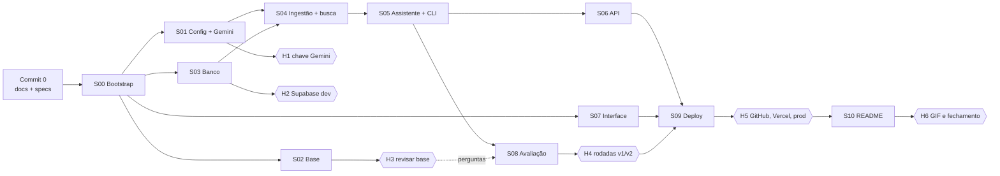

# Specs — Chapa

As specs dividem o projeto em pacotes de trabalho que **um subagente consegue executar sozinho**, com arquivos próprios, contratos escritos por extenso e critérios de aceite verificáveis. Toda spec segue o [`_template.md`](_template.md) e se sustenta sozinha: quem implementa lê só o `AGENTS.md`, o `ARCHITECTURE.md` e a spec.

## Status

Só uma spec `✅ Aprovada` e com as dependências concluídas pode ser implementada. Uma spec nova começa como `🟡 Aguardando aprovação` e só passa para `✅` depois que a pessoa aprova.

Legenda: 🟡 Aguardando aprovação · ✅ Aprovada · 🔵 Em andamento · 🟢 Concluída · ⛔ Bloqueada

## Índice

| ID | Spec | Onda | Depende de | Esforço | Usa API | Status |
|---|---|---|---|---|---|---|
| S00 | [Bootstrap do projeto Next.js](S00-bootstrap.md) | 0 | commit 0 | 45 min | não | 🟢 |
| S01 | [Configuração e cliente do Gemini](S01-config-e-cliente-llm.md) | 1 | S00 | 1h | fumaça (H1) | 🟢 |
| S02 | [Base de conhecimento](S02-base-de-conhecimento.md) | 1 | S00 | 1h30 | não (web) | 🟢 |
| S03 | [Banco de dados e repositórios](S03-banco-de-dados.md) | 1 | S00 | 1h15 | não (banco no H2) | 🟢 |
| S04 | [Ingestão e busca híbrida](S04-ingestao-e-busca.md) | 2 | S01, S03 | 1h15 | ingest | 🟢 |
| S07 | [Interface de chat](S07-interface-de-chat.md) | 2 | S00 | 2h | manual | 🟢 |
| S05 | [Assistente: guardrails, memória, prompts e CLI](S05-assistente.md) | 3 | S01, S03, S04 | 2h | manual | 🟢 |
| S06 | [API: rotas, rate limit, logs e cron](S06-api.md) | 4 | S05 | 1h30 | manual | 🟢 |
| S08 | [Avaliação](S08-avaliacao.md) | 4 | S05 (perguntas: S02 + H3) | 1h30 + rodadas | **sim** (H4) | 🟢 |
| S09 | [Deploy na Vercel e banco de produção](S09-deploy.md) | 5 | S06, S07, S08 | 45 min + humano | sim (H5) | 🟢 |
| S10 | [Documentação final](S10-documentacao.md) | 6 | S08, S09 | 1h30 | não | 🟢 |

## Ondas de execução com subagentes

| Onda | Em paralelo | Por que é seguro paralelizar |
|---|---|---|
| 0 | S00 | Sozinha: cria a estrutura, instala as dependências e escreve os contratos |
| 1 | **S01 ∥ S02 ∥ S03** | Arquivos disjuntos: `src/config.ts` + `src/infra/llm/` / `knowledge-base/` / `supabase/` + `src/infra/db/` |
| 2 | **S04 ∥ S07** | `src/core/rag/` + `scripts/ingest.ts` / `src/app/page.tsx` + `src/components/` + `src/lib/` (só a S07 mexe no `package.json`, via `shadcn add`) |
| 3 | S05 | Depende de `retrieve` (S04) e dos repositórios (S03) |
| 4 | **S06 ∥ S08** | `src/app/api/` + `next.config.ts` + `vercel.json` / `scripts/eval/` + `eval/` |
| 5 | S09 | Precisa da API, da interface e do preset calibrado |
| 6 | S10 | Precisa dos números e do link da demo |

A S07 pode começar na onda 1, se houver folga, porque só depende dos contratos da S00. Ela fica na onda 2 para limitar a 3 subagentes por vez.

## Commit 0 (antes da S00)

O primeiro commit tem **só a documentação e as specs**: `README.md`, `ARCHITECTURE.md`, `AGENTS.md`, `CLAUDE.md`, `.gitignore`, `specs/`, `docs/adr/`, `.claude/agents/` e `.github/pull_request_template.md`. O repositório já tem `git init`. **A pessoa faz esse commit**, direto na `main`, depois de conferir com `git status --porcelain -uall` que só esses arquivos aparecem (o `.env.local`, o `.env.prod.local` e o `.vscode/` ficam de fora pelo `.gitignore`): `docs: add readme, architecture, agent rules, ADRs and specs`. É o único commit fora de PR.

Logo depois vem o **H0b**: a pessoa cria o repositório no GitHub e faz o push da `main` (`gh repo create chapa --private --source=. --remote=origin --push`). O orquestrador começa pela S00 só depois disso. A partir daí, toda spec é uma branch, um worktree e um PR (ver a seção "Git" do `AGENTS.md`).

## Status durante as ondas

Na branch, cada spec atualiza só o status do próprio arquivo. Este índice é atualizado no PR `docs(specs): close wave N`, depois que todos os PRs da onda entram, para que os PRs paralelos não entrem em conflito nesta tabela.

## Checkpoints humanos

Parte das ações abaixo já está autorizada. Veja a seção "Autorizações prévias" do [`CLAUDE.md`](../CLAUDE.md).

| ID | Quando | O que você faz |
|---|---|---|
| **H0** | Antes do commit 0 | Aprovar as specs. |
| **H0b** | Depois do commit 0 | Criar o repositório no GitHub (pode ser privado até o H5), fazer o push da `main` e conferir que o `gh` está autenticado. Opcional: proteger a `main` exigindo PR e a CI verde. |
| **H1** | Antes da fumaça da S01 | Criar a chave do Gemini no Google AI Studio, sem cartão, e colocá-la no `.env.local` como `GEMINI_API_KEY`. |
| **H2** | Depois da S03 | Criar os projetos Supabase `dev` e `prod` em `sa-east-1`. Colocar a connection string do pooler em modo transação (porta 6543) do `dev` no `.env.local` como `DATABASE_URL`. Gerar `IP_HASH_SECRET` e `CRON_SECRET` com `openssl rand -hex 32`. Rodar `npx supabase link --project-ref <dev>` e `npx supabase db push --remote` (no CLI 3, sem `--remote` o comando mira o banco local). Autorizar (ou não) o agente a usar o `dev` nas verificações manuais. |
| **H3** | Depois da S02 | Revisar os 7 documentos da base: números, procedimentos e tom. A ingestão só roda depois disso. |
| **H4** | Depois da S08 | Autorizar as rodadas de avaliação (v1, calibração e v2) no plano gratuito do Gemini. |
| **H5** | S09 | Tornar o repositório público, se ainda for privado; aplicar a migração e a ingestão no `prod`; criar o projeto na Vercel e configurar as variáveis de Production e Preview; autorizar o smoke contra a produção. |
| **H6** | Depois da S10 | Gravar o GIF da demo, informar o nome para a licença e fixar o repositório no perfil. |

## Riscos principais

| Risco | Mitigação |
|---|---|
| Cota gratuita do Gemini estoura no eval ou na demo | `--delay-ms` e `--only` no eval, Flash-Lite no chat e nas tarefas auxiliares ([ADR 0014](../docs/adr/0014-flash-lite-como-modelo-de-chat.md)), juiz opcional, rate limit por IP por minuto e por dia |
| Limites dos planos gratuitos mudaram | Conferência obrigatória no passo 1 do `DEPLOY.md` (S09), antes do deploy |
| As páginas oficiais não trazem os números | Texto genérico na base, e a lacuna vira pergunta de fallback no eval |
| `minScore` mal calibrado (falsa recusa ou alucinação) | Calibração de uma variável por vez, registrada em `CALIBRACAO.md` |
| Vetores de modelos ou chunkings diferentes misturados | Toda busca filtra por `embedding_model` e `chunk_config` |
| Dados de teste sujam a demo | Projetos Supabase `dev` e `prod` separados. Preview e eval usam o `dev` |
| Chave ou link de sessão vazam | Chaves só no servidor, sem `NEXT_PUBLIC_`, teste de arquitetura, `Referrer-Policy: no-referrer`, logs sem conteúdo e expiração em 7 dias |
| Supabase gratuito pausa por inatividade | O cron diário acessa o banco |
